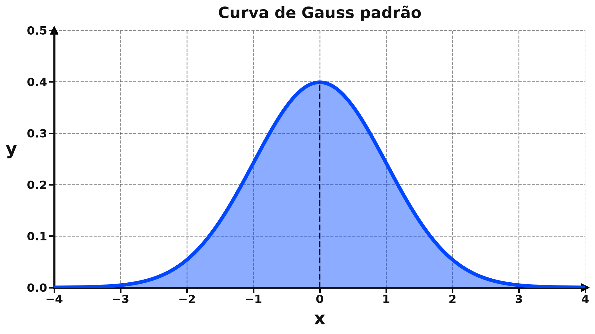
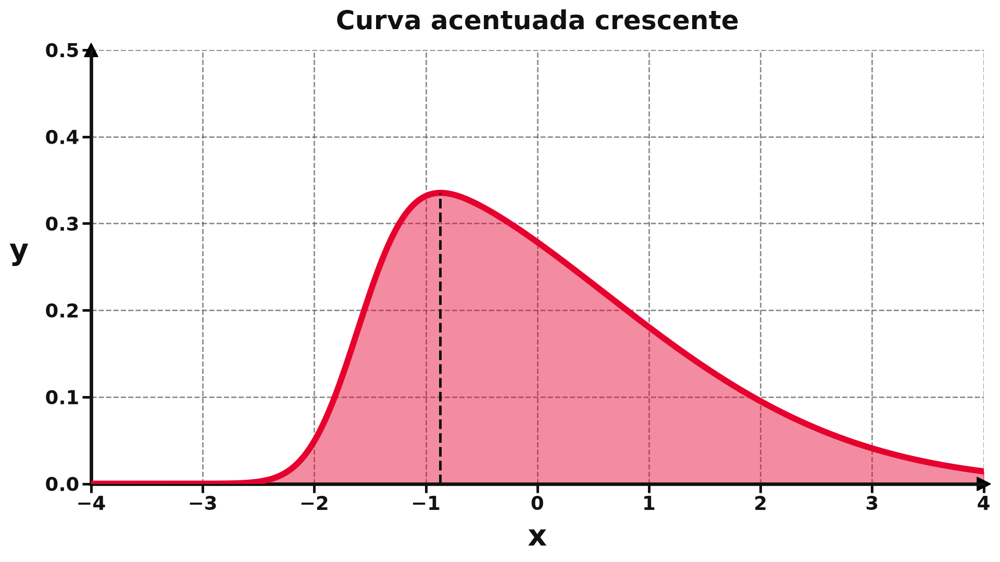
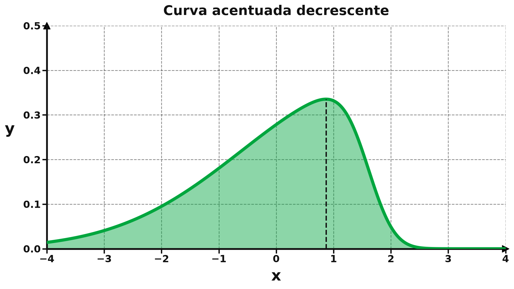

# Curvas de Gauss para projetor

Três curvas de Gauss em cores fortes para projeção em parede branca: padrão (azul, simétrica), acentuada crescente (vermelha, com assimetria positiva) e acentuada decrescente (verde, com assimetria negativa).

## Imagens







## Como regenerar

```bash
pip install -r requirements.txt
python gerar.py
```
